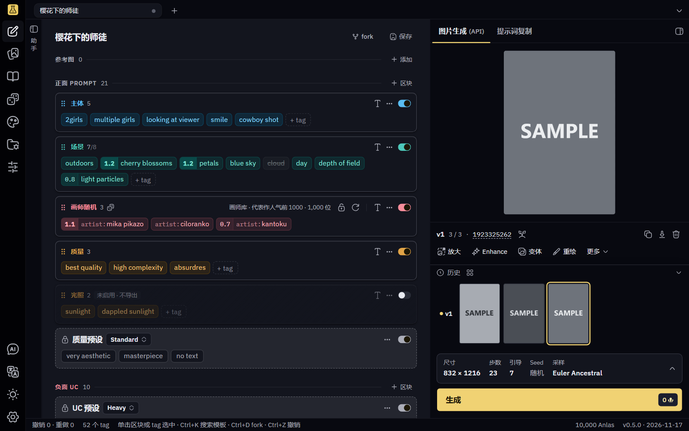
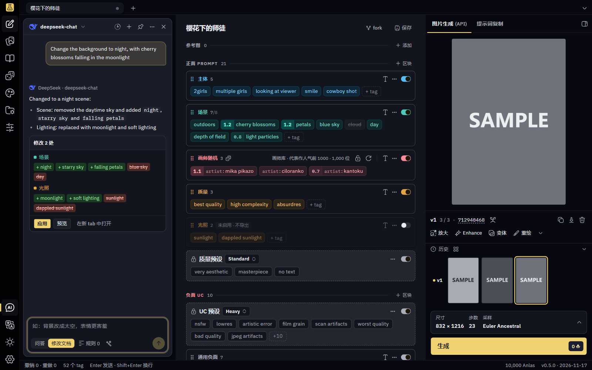

<p align="center"></p>
<h1 align="center">Tincture</h1>
<p align="center">A desktop prompt editor for NovelAI image generation</p>
<p align="center">
  <a href="https://github.com/setuna00/tincture/releases/latest">Download</a> ·
  <a href="README.md">中文</a> ·
  <a href="https://github.com/setuna00/tincture/releases/latest"></a>
  <a href="LICENSE"></a>
</p>

> The interface is currently available in Chinese only. Tags can be displayed under their English names, as in the screenshots below.



Tincture organizes a prompt into blocks. Each block holds a group of related tags and can be reordered, enabled or disabled independently, and tag weights are adjusted with the mouse wheel instead of being typed as brackets or numbers. The tag data is built on Danbooru and follows the spelling used by NovelAI's tag suggestions. Around forty thousand common tags also carry Chinese names and descriptions, so they can be searched in English, Chinese or pinyin, and tags that are frequently used together are suggested while typing.

Finished blocks and characters can be saved as templates and dragged into other documents. Random blocks draw their contents from the artist library or from tag categories according to configurable rules. When a prompt involves dozens of tags and the composition and style are adjusted many times over, this structure remains easier to read than a single text field, and it makes working combinations straightforward to keep and reuse.

Once a NovelAI API token is configured, images can be generated within the application. Results are saved to a local gallery, and each document keeps a record of its versions. A third-party AI service can also be connected to revise the prompt; its proposed changes are first listed item by item in a preview and are applied only after confirmation. Without a token, all editing features remain available, and the finished prompt can be copied to the NovelAI website.



## Further features

- Artist library: about 49,000 Danbooru artists with representative works, which can be browsed by subject, organized into collections, or drawn at random in a random block
- Tag encyclopedia: tags arranged by category with Chinese descriptions, which can be collected into custom lists
- Image generation: generation parameters, characters and reference images for V4, V4.5 and V5, together with upscaling, Enhance, variations and inpainting
- NovelAI interoperability: prompts and parameters can be imported from images generated by NovelAI, and the current document can be copied as an image that NovelAI reads directly
- AI agents: tools such as Claude Code and Cursor can read and edit documents through MCP

## Download and usage

Requirements: Windows 10 or Windows 11 (64-bit).

Download `Tincture-x.y.z.zip` from the [Releases](https://github.com/setuna00/tincture/releases) page, extract it and run `Tincture.exe`; no installation is required. Because the application is not yet code-signed, Windows SmartScreen may display a warning on first launch. Selecting "More info" and then "Run anyway" starts the application.

Generating images within the application requires a NovelAI subscription and a Persistent API Token. The token can be created in NovelAI's account settings and entered in Tincture under 设置 → NAI 账号 (Settings → NAI Account).

## Development

Development requires Node.js 24 or later, and dependencies are installed with pnpm.

```bash
pnpm install
npm run dev:test   # start in test mode with a temporary library, leaving local data untouched
npm run release    # build the portable version into the release/ directory
```

## Notices

This is an unofficial project and is not affiliated with NovelAI or Anlatan. NovelAI is a trademark of Anlatan. Network access and data storage are described in [PRIVACY.md](PRIVACY.md), and licensing information for third-party data and dependencies is given in [THIRD_PARTY_NOTICES.md](THIRD_PARTY_NOTICES.md); both documents are written in Chinese.

## License

This project is released under the Apache License 2.0.
