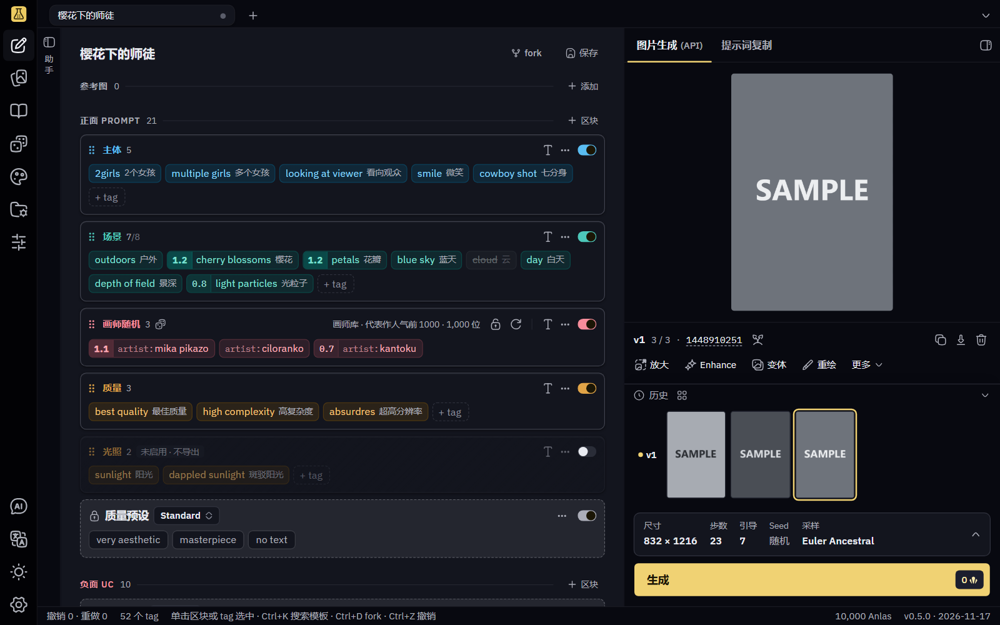
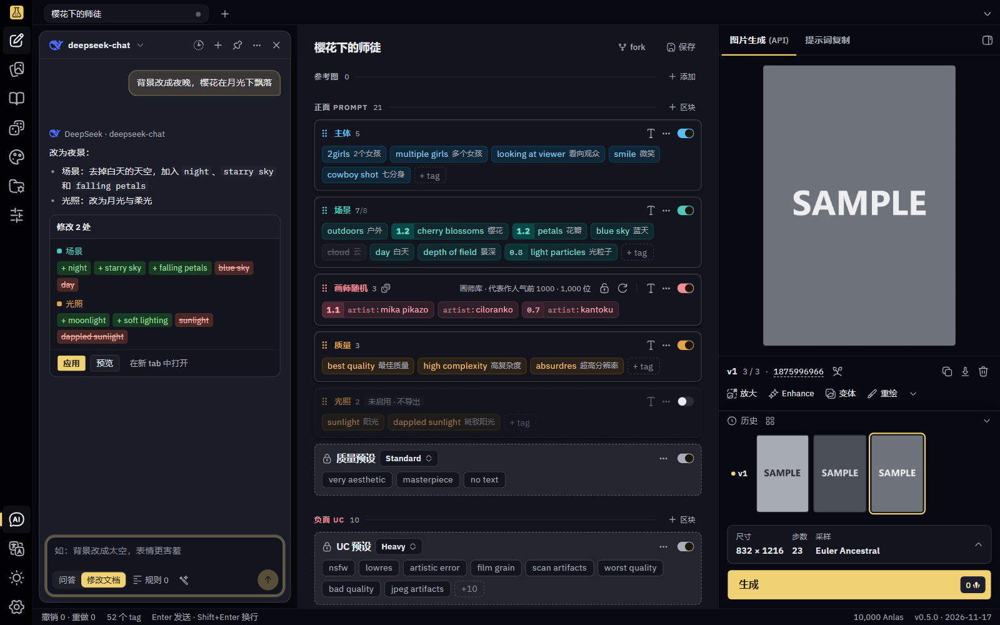

<p align="center"></p>
<h1 align="center">Tincture</h1>
<p align="center">面向 NovelAI 图像生成的桌面端 Prompt 编辑器</p>
<p align="center">
  <a href="https://github.com/setuna00/tincture/releases/latest">下载</a> ·
  <a href="README.en.md">English</a> ·
  <a href="https://github.com/setuna00/tincture/releases/latest"></a>
  <a href="LICENSE"></a>
</p>



Tincture 以区块为单位组织 Prompt。每个区块包含一组相关的 tag，可以单独拖动排序、启用或停用；tag 权重通过滚轮即可调整，无需手动输入括号或数值。tag 数据以 Danbooru 为基础，写法与 NovelAI 的 tag 补全保持一致，并为约四万个常用 tag 提供中文名称与释义，支持中文及拼音检索，输入时还会推荐常用的搭配。

编辑好的区块和角色可以保存为模板，在其他文档中直接拖入复用；随机区块可按规则从画师库或 tag 分类中抽取内容。在需要同时管理数十个 tag、反复调整构图与风格时，这种方式比在单个文本框中编辑整段 Prompt 更清晰，也便于积累可复用的组合。

配置 NovelAI API 令牌后，可在应用内直接生成图像，结果自动保存至本地图库，并按文档记录版本。也可以接入第三方 AI 服务修改 Prompt，修改内容会先以预览形式逐项列出，确认后再应用。未配置令牌时，同样可以完成编辑，再将 Prompt 复制到 NovelAI 网页端使用。



## 其他功能

- 画师库：收录约 4.9 万位 Danbooru 画师及其代表作品，可按题材查找、整理成合集，或在随机区块中抽取
- 百科：按分类浏览 tag 及其中文释义，可整理为自定义列表
- 出图工具：支持 V4、V4.5、V5 的生成参数、角色与参考图，以及放大、Enhance、变体与局部重绘
- 与 NovelAI 互通：可从 NovelAI 生成的图像中导入 Prompt 与参数，也可将当前文档复制为 NovelAI 能直接读取的图像
- AI 代理：通过 MCP，让 Claude Code、Cursor 等工具读取和编辑文档

## 下载与使用

系统要求：Windows 10 或 Windows 11（64 位）。

请在 [Releases](https://github.com/setuna00/tincture/releases) 页面下载 `Tincture-x.y.z.zip`，解压后运行 `Tincture.exe`，无需安装。由于应用暂未进行代码签名，首次运行时 Windows SmartScreen 可能出现安全提示，选择「更多信息」后点击「仍要运行」即可。

在应用内生成图像需要 NovelAI 订阅及 Persistent API Token。令牌可在 NovelAI 的账户设置中生成，填入本应用的「设置 → NAI 账号」后即可使用。

## 开发

开发环境需要 Node.js 24 或更高版本，依赖通过 pnpm 安装。

```bash
pnpm install
npm run dev:test   # 以测试模式启动，使用临时图库，不影响本地数据
npm run release    # 构建便携版，输出至 release/ 目录
```

## 声明

本项目为非官方项目，与 NovelAI 及 Anlatan 无任何关联，NovelAI 是 Anlatan 的商标。应用的网络访问与数据存储方式详见 [PRIVACY.md](PRIVACY.md)，第三方数据与依赖的许可信息详见 [THIRD_PARTY_NOTICES.md](THIRD_PARTY_NOTICES.md)。

## 许可证

本项目基于 Apache License 2.0 开源。
